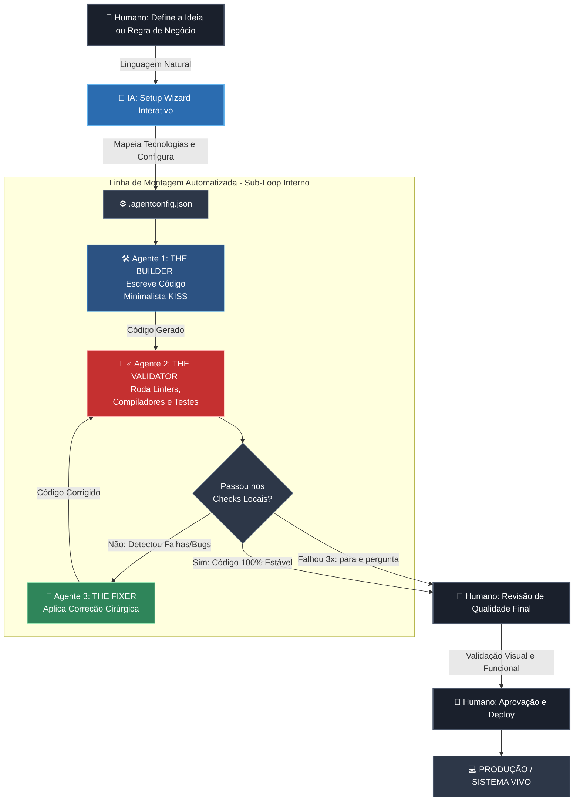

# 🏭 Universal Agentic Software Factory (UAH)

Este repositório contém o modelo arquitetural de **Fábrica de Software Agêntica** projetado para desenvolvimento solo de alta performance auxiliado por Inteligência Artificial (ex: Claude Code, Cursor, Copilot).

O objetivo deste harness é desacoplar totalmente o **comportamento e a governança da IA** (estabilidade, qualidade, auditoria e geração de logs) do **stack tecnológico mutável** do projeto, garantindo que a sua esteira de engenharia nunca fique obsoleta.

---

## 🏗️ Estrutura do Sistema

```text
.
├── CLAUDE.md                  # Carrega o AGENTS_CORE automaticamente no Claude Code
├── AGENTS.md                  # Mesmo papel para Cursor, Copilot, Codex e afins
├── .agent-harness/
│   ├── AGENTS_CORE.md         # Princípios Universais (KISS, Clean Code, Protocolo Multi-Agente)
│   ├── SETUP_PROMPT.md        # Prompt inicial para ativação do Setup Wizard
│   ├── REVIEW_PROMPT.md       # Revisão independente (sessão nova) para trabalho de alto risco
│   ├── presets/               # .agentconfig.json prontos: Next.js, FastAPI, Kotlin/Android
│   ├── changelog/
│   │   └── updates.md         # Histórico datado de alterações
│   ├── mcp/
│   │   ├── mcp-config.json    # Servidores MCP ativos (somente filesystem por padrão)
│   │   └── mcp-config.postgres.example.json  # Opcional: inspeção de PostgreSQL
│   ├── memory/
│   │   └── ctx_memory.md      # Memória de Contexto Contínua e decisões do projeto
│   └── logs/
│       ├── mapping/           # Mapeamentos gráficos e textuais de bugs (Graphify)
│       └── archive/           # Histórico de erros e soluções (Base de Conhecimento)
├── .agentconfig.json          # Metadados dinâmicos e comandos de validação do stack atual
├── .env.example               # Modelo de variáveis de ambiente e chaves de API protegidas
└── .gitignore                 # Filtro de segurança para impedir o envio de chaves privadas ao Git
```

---

## 🤖 O Protocolo Multi-Agente Interno

Toda interação realizada através deste harness força a IA a simular internamente um ciclo de 3 papéis distintos antes de entregar ou salvar qualquer código, quebrando o viés de confirmação:

1. **THE BUILDER (O Criador):** Foca na velocidade e na entrega das regras de negócio solicitadas pelo usuário em linguagem natural.
2. **THE VALIDATOR (O Validador):** Atua de forma adversarial. Audita o código contra alucinações, falta de tipagem ou complexidade excessiva, executando ferramentas locais como linters e compiladores.
3. **THE FIXER (O Reparador):** Intercepta os relatórios de erro do validador e realiza correções cirúrgicas nos arquivos antes da validação final.

Regras de segurança do ciclo: o Validador precisa **rodar comandos reais** (lint, tipos, testes) e citar o resultado; no máximo **3 ciclos de correção** antes de parar e perguntar; nunca enfraquecer um teste para ele passar; ações destrutivas, `git push`, migrations e deploys exigem aprovação humana.

O desenvolvedor humano atua estritamente como **Human-in-the-Loop**, analisando o diff de alterações, revisando logs e controlando 100% dos envios para ambiente vivo.

---

## 🗺️ Fluxograma Operacional: Linha de Montagem Homem-IA

Abaixo está o mapeamento visual de execução de tarefas dentro deste ecossistema. O GitHub renderiza este gráfico automaticamente:



---

## ⚠️ Limites Honestos

Tags XML e instruções em inglês melhoram a obediência e reduzem custo de tokens, mas **não eliminam alucinações nem garantem 100% de conformidade**. A segurança real vem dos comandos de validação executados, dos limites de iteração e da revisão humana. Para auth, pagamentos e migrations, rode também `.agent-harness/REVIEW_PROMPT.md` em uma sessão nova.

---

## 🚀 Como Utilizar no Dia a Dia

1. **Clone este modelo** (ou copie a pasta `.agent-harness`) para a raiz de qualquer novo projeto.
2. Abra a pasta do projeto no seu **VS Code**.
3. Inicialize o seu agente de IA de preferência (abra o terminal do `claude code` ou o painel de chat do Cursor).
4. Abra o arquivo `.agent-harness/SETUP_PROMPT.md`, copie o seu conteúdo e envie no chat do agente para ativar o **Setup Wizard**.
5. Responda sequencialmente às perguntas da IA para configurar as diretivas tecnológicas automáticas do arquivo `.agentconfig.json`.
6. Comece a criar suas funcionalidades enviando comandos diretos em linguagem natural.
